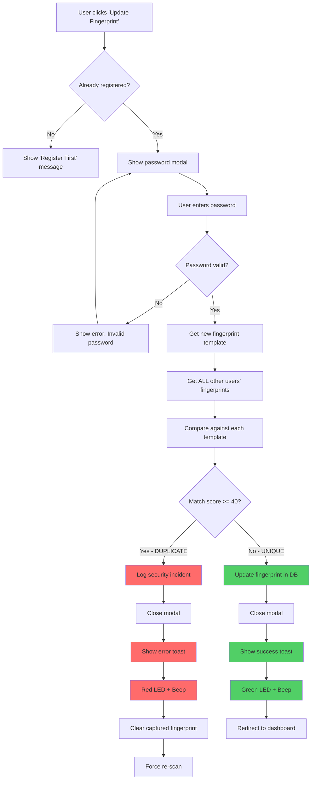
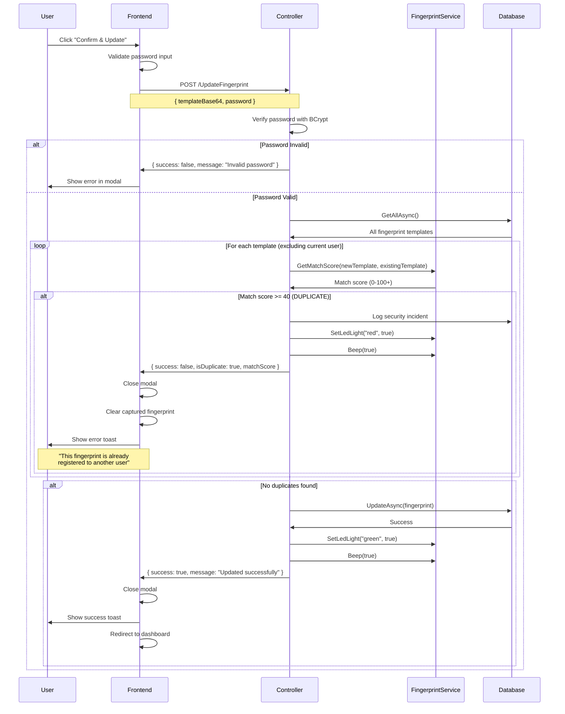
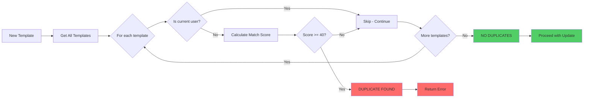
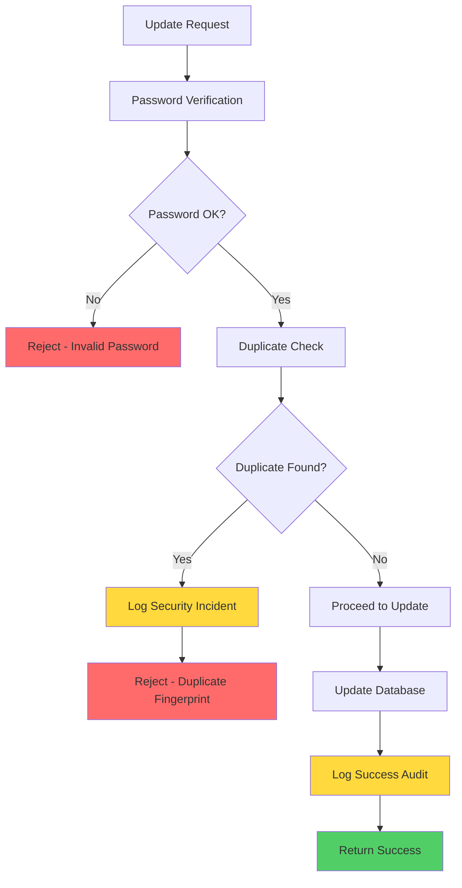
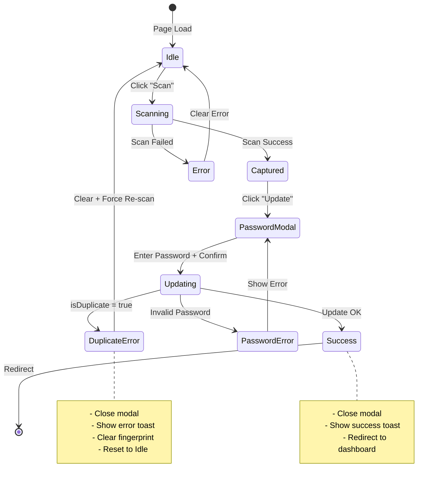
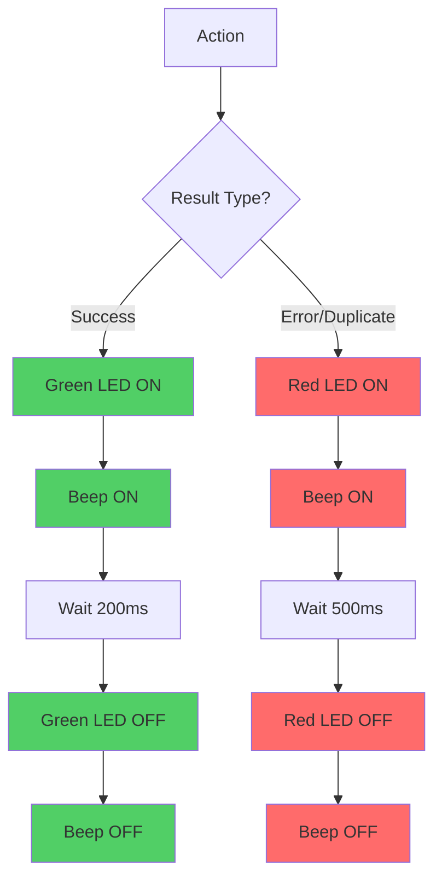
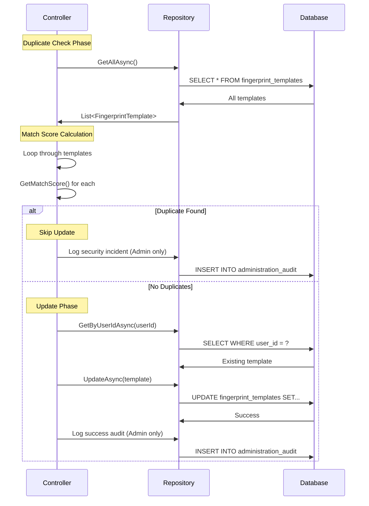
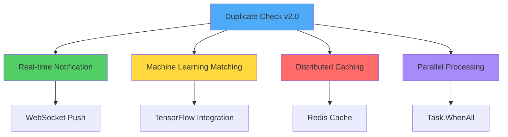

# ?? Duplicate Fingerprint Check - Flow Diagrams

## ?? Complete Update Process Flow



---

## ?? Detailed Duplicate Check Algorithm



---

## ?? Match Score Comparison Logic



---

## ?? Match Score Interpretation

```
Match Score Range:
??? 0-10    ? Very different fingerprints ? Safe to register
??? 10-30   ? Somewhat similar ? Safe to register
??? 30-40   ? Similar but acceptable ?? Edge case
??? 40-60 ? Duplicate detected ? REJECT
??? 60-100+ ? Strong duplicate ? REJECT (high confidence)

Threshold for Login: 50
Threshold for Duplicate Check: 40 (more strict)
```

---

## ?? Security Flow



---

## ?? Frontend State Machine



---

## ?? Audio/Visual Feedback Flow



---

## ?? Performance Analysis

```
Time Complexity Analysis:
??? GetAllAsync(): O(n) where n = total users
??? For loop: O(n) iterations
??? GetMatchScore(): O(1) per comparison
??? Total: O(n) - Linear time complexity

Space Complexity:
??? allTemplates array: O(n)
??? newTemplateData: O(1)
??? Total: O(n) - Linear space complexity

Performance Benchmarks:
??? 10 users: ~10ms
??? 50 users: ~50ms
??? 100 users: ~100ms
??? 500 users: ~500ms
??? 1000 users: ~1 second
```

---

## ??? Database Interaction Flow



---

## ?? User Interface Flow

```
???????????????????????????????????????????????
?   Register Fingerprint Page      ?
???????????????????????????????????????????????
?     ?
?  Scanner Status: [?] Online          ?
?Registration Status: [?] Registered        ?
??
?        ???????????????????       ?
?        ?   ???????????   ?          ?
?    ?  ? ?? Scan  ?   ?        ?
?        ?   ???????????   ? ?
?        ???????????????????    ?
?   ?
?     [Scan Fingerprint]       ?
?     [Update Fingerprint]  [Cancel]        ?
?        ?
???????????????????????????????????????????????

? Click "Update Fingerprint"

???????????????????????????????????????????????
?   Password Confirmation Modal          ?
???????????????????????????????????????????????
?        ??? Update Fingerprint      ?
?   ?
?  You already have a registered fingerprint. ?
?  Please confirm your password to update it. ?
?        ?
?  Password: [********************]  ???       ?
?           ?
?    [Cancel]  [Confirm & Update]    ?
???????????????????????????????????????????????

    ? Enter password + Click "Confirm"

???????????????????????????????????????????????
?  ? Error Toast (Duplicate)        ?
? ?
?  This fingerprint is already registered     ?
?  to another user. Please use a different    ?
?  finger.        ?
???????????????????????????????????????????????

    OR

???????????????????????????????????????????????
?  ? Success Toast                    ?
?               ?
?  Fingerprint updated successfully!          ?
?  Redirecting to your dashboard...           ?
???????????????????????????????????????????????
```

---

## ?? Optimization Strategies

### Current Implementation (Synchronous):
```
User Request ? Check All Templates ? Update ? Response
Time: O(n) where n = number of users
```

### Future Enhancement (Asynchronous):
```
User Request ? Update Immediately ? Response
    ?
Background Job ? Check Duplicates ? Alert if Found
Time: O(1) for user, O(n) in background
```

### Caching Strategy:
```
First Request:
    Database ? Cache ? Response (slow)

Subsequent Requests:
    Cache ? Response (fast, 5-minute TTL)
```

---

## ?? Advanced Features (Future)



---

## ?? Legend

### Colors:
- ?? Green = Success / Safe
- ?? Red = Error / Duplicate
- ?? Yellow = Warning / Edge Case
- ?? Blue = Information / Process

### Symbols:
- ? = Success
- ? = Error
- ?? = Warning
- ?? = Security
- ?? = Audio/Visual Feedback
- ?? = Performance
- ?? = Goal/Target

---

**Flow Diagrams Version:** 1.0  
**Last Updated:** 2025-01-29  
**Status:** ? COMPLETE

---

**For more details, see:**
- `DUPLICATE_FINGERPRINT_CHECK_IMPLEMENTATION.md` - Full implementation guide
- `DUPLICATE_CHECK_TEST_GUIDE.md` - Testing procedures
